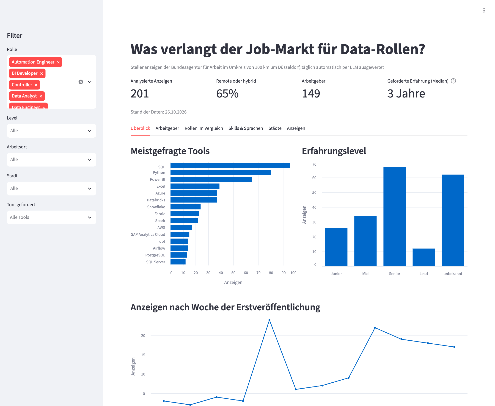
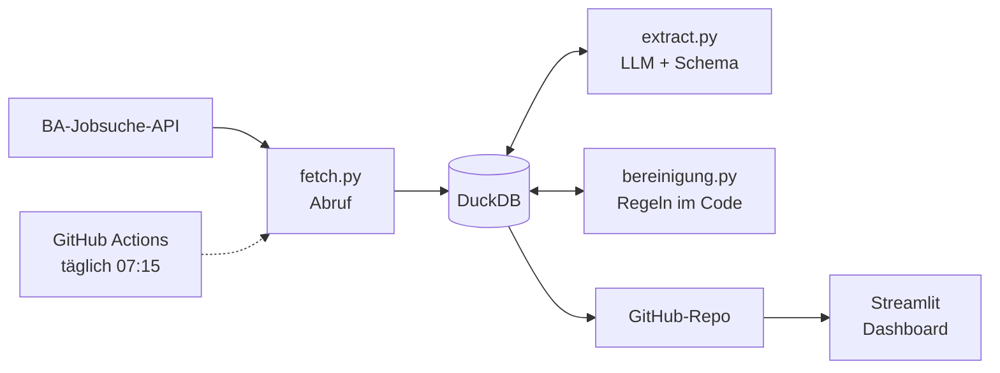

# Job-Markt-Analyse NRW

Automatische Pipeline, die täglich Stellenanzeigen für Data-Rollen sammelt,
per LLM in strukturierte Daten verwandelt und als Live-Dashboard veröffentlicht.

**Live-Dashboard:** https://jobmarkt-nrw.streamlit.app



## Ergebnisse (Stand: Oktober 2026)

- **403 Anzeigen** im Umkreis von 100 km um Düsseldorf ausgewertet, davon **192 Data-Rollen**
- Häufigste Tools in Data-Rollen: **SQL (47 %)**, **Python (39 %)**, **Power BI (31 %)**
- Bei Data-Analyst-Stellen: SQL in 54 %, Power BI in 46 %, Python in 30 %
- **65 %** der Stellen bieten hybrides oder Remote-Arbeiten

## Architektur



1. **Abruf:** Täglich werden neue Anzeigen der letzten 7 Tage geholt (mit Pagination und Retry). Bekannte Anzeigen werden über die Referenznummer übersprungen, die Pipeline ist idempotent. Ein Titel-Filter sortiert fachfremde Treffer vor der LLM-Analyse aus (geprüft an 449 Anzeigen: 94 % der passenden bleiben, gut die Hälfte der fachfremden fällt weg). Neu geschaltete Kopien derselben Stelle (gleicher Titel und Arbeitgeber) werden nur einmal gezählt.
2. **Extraktion:** Claude Haiku füllt pro Anzeige ein festes Schema aus (Rolle, Level, Tools, Skills, Sprachen, Remote, Erfahrungsjahre). Structured Outputs und Pydantic garantieren gültige Werte.
3. **Bereinigung:** Feste Regeln im Code vereinheitlichen Tool-Namen (z. B. „Microsoft Fabric“ → „Fabric“) und begrenzen die Listen. Neue Regeln werden bei jedem Lauf auch auf alte Daten angewendet, ohne neue LLM-Kosten.
4. **Automatisierung:** GitHub Actions führt Tests und Pipeline täglich aus und committet die aktualisierte Datenbank.
5. **Dashboard:** Streamlit liest die Datenbank direkt aus dem Repository. Filter nach Rolle, Level, Arbeitsort, Stadt und Tool; Vergleich der Rollen, aktivste Arbeitgeber mit Link zur Original-Anzeige.

## Technik

Python · DuckDB · Anthropic API (Structured Outputs) · Pydantic ·
GitHub Actions · Streamlit · pytest · ruff · uv

## Qualität der KI-Extraktion

Stichprobe von 20 Anzeigen gegen den Originaltext geprüft
([docs/stichprobe.csv](docs/stichprobe.csv)):

| Feld   | Trefferquote |
|--------|--------------|
| Rolle  | 90 %         |
| Level  | 80 %         |
| Remote | 90 %         |
| Tools  | 95 %         |

**Verbesserung durch Prompt-Version 2:** Die erste Version hat Homeoffice-Angaben
im Abschnitt „Wir bieten“ oft übersehen. Ein Abgleich mit dem Anzeigentext zeigte
25 falsche „unbekannt“-Werte. Nach klaren Regeln pro Feld waren es noch 3.

## Lokal ausführen

```bash
uv sync
cp .env.example .env   # ANTHROPIC_API_KEY eintragen
uv run pytest
uv run python -m jobmarkt.pipeline
uv run streamlit run app/dashboard.py
```

## Was ich gelernt habe

- **Inoffizielle APIs ändern sich:** Während des Projekts hat die Bundesagentur die
  Suche von v4 auf v6 umgestellt (neue Feldnamen). Tests auf die Feldzuordnung
  machen solche Änderungen sofort sichtbar.
- **LLM-Ergebnisse muss man messen:** Erst die Stichprobe hat gezeigt, wo der
  Prompt ungenau war.
- **Feste Regeln gehören in den Code:** Vorgaben wie „höchstens 10 Tools“ befolgt
  das LLM nicht immer zuverlässig, Code dagegen schon.

## Nächste Schritte

- Level- und Remote-Regeln weiter schärfen und die Qualität neu messen
- Firmennamen vereinheitlichen (z. B. „Deichmann“ und „Deichmann SE“)
- Vergleich weiterer Regionen (z. B. Berlin, München)
- Auswertung von Gehaltsangaben

## Datenquelle

Stellenanzeigen der [Bundesagentur für Arbeit](https://www.arbeitsagentur.de/jobsuche/),
Zugang dokumentiert vom Projekt [bundesAPI](https://github.com/bundesAPI/jobsuche-api).
Nicht-kommerzielles Lernprojekt. Es werden nur eigene Auswertungen veröffentlicht,
keine vollständigen Anzeigentexte.
